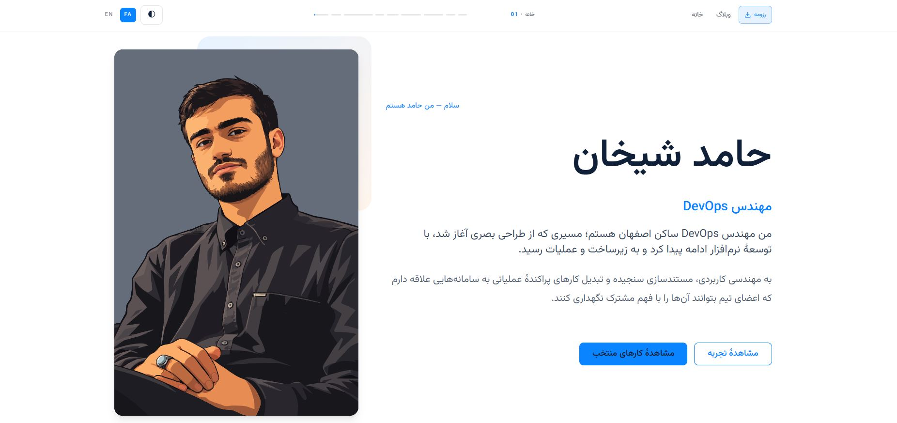

# پورتفولیوی راوان

**قالبی دوزبانه و قابل نگهداری با کمک هوش مصنوعی برای ساخت کارنامهٔ حرفه‌ای، بر پایهٔ Astro.**

[](LICENSE.md) [](https://astro.build/) [](https://tailwindcss.com/)

[](public/images/portfolio-preview.jpg)

این پروژه یک چارچوب قابل استفادهٔ مجدد برای ساخت وب‌سایت شخصی توسعه‌دهندگان، مهندسان، طراحان و تیم‌های فنی است. سایت از مسیرهای انگلیسی و فارسی، چیدمان راست‌به‌چپ و چپ‌به‌راست، حالت روشن و تاریک، وبلاگ MDX و محتوای متمرکز در پوشهٔ `content/` پشتیبانی می‌کند.

این پروژه بر پایهٔ [Astro Multilingual Portfolio Template](https://github.com/nicremo/astro-multilingual-portfolio-template) اثر Fabian Bitzer شکل گرفته است. طراحی اولیه، ساختار واکنش‌گرا، تغییر پوسته، ناوبری چندزبانه و مجوز MIT پروژهٔ مادر حفظ شده و قابلیت‌های محتوایی، انتشار فنی، اعتبارسنجی، رزومه و مهارت‌های Agent به آن افزوده شده‌اند.

تصویر پیش‌نمایش ابتدای این README نسخهٔ مرجع این انتشار است و در مسیر `public/images/portfolio-preview.jpg` نگهداری می‌شود تا GitHub و نسخهٔ محلی مخزن از یک تصویر استفاده کنند.

English documentation: [README.md](README.md)

## امکانات

- مسیرهای انگلیسی `/en/` و فارسی `/fa/` با پشتیبانی کامل از RTL و LTR
- طراحی واکنش‌گرا برای موبایل، تبلت و دسکتاپ
- پوستهٔ روشن و تاریک با تشخیص تنظیمات سیستم و تغییر دستی
- نوار ناوبری چسبان و نوار پیشرفت بخش‌های صفحهٔ اصلی
- بخش‌های Hero، درباره، تمرکز حرفه‌ای، مهارت‌ها و ابزارها، تجربه، مسیر حرفه‌ای، پروژه‌ها و ارتباط
- حالت‌های خالی و راهنمای قابل فهم برای یک قالب تازه و بدون مالک مشخص
- وبلاگ چندزبانه با Markdown/MDX، پوشه‌بندی موضوعی، دسته‌بندی، برچسب و مقالهٔ پیش‌نویس
- نمایش Mermaid، Markmap، فرمول‌های KaTeX و فایل‌های PDF پیوست
- جست‌وجوی تولیدی با Pagefind و فید RSS برای هر زبان
- تولید اختیاری رزومهٔ PDF فارسی و انگلیسی با دادهٔ مرکزی و فونت Vazirmatn
- ابزارهای Agent محلی برای ویرایش امن محتوا و بررسی ساختار
- گردش‌کار CI و استقرار Vercel

## فناوری‌ها

- Astro 5، TypeScript و خروجی استاتیک
- Tailwind CSS و `@astrojs/tailwind`
- Astro Content Collections و `@astrojs/mdx`
- Preact برای بخش‌های تعاملی
- Vazirmatn، Lucide، Mermaid، Markmap و KaTeX
- Pagefind برای جست‌وجوی تولیدی
- npm و فایل قفل `package-lock.json`

## شروع سریع

```sh
git clone <your-repository-url>
cd portfolio
npm ci
npm run dev
```

سپس `http://localhost:4321/en/` یا `http://localhost:4321/fa/` را باز کنید. برای بررسی و ساخت نسخهٔ تولیدی:

```sh
npm run content:validate
npm run content:check-links
npm run check
npm run build
npm run preview
```

## ساختار مخزن

```text
src/                 صفحات، layoutها، کامپوننت‌ها، استایل‌ها و ابزارها
content/             اطلاعات مالک سایت، مقاله‌ها، رسانه و تنظیمات رزومه
.agents/skills/      راهنمای محلی برای نگهداری محتوا
design/              مستندات معماری و تصمیم‌های مهندسی
scripts/             ابزارهای اعتبارسنجی، لینک، رزومه و بررسی خروجی
.github/workflows/   گردش‌کار CI و استقرار Vercel
tests/fixtures/      نمونه‌های ساختگی ایزوله برای آزمون
```

## شخصی‌سازی محتوا

اطلاعات عمومی مالک سایت فقط باید در `content/` قرار بگیرد:

1. عنوان، توضیح و آدرس سایت را در `content/site.json` تنظیم کنید.
2. در `content/profile.json` مقدار `visible` را فعال کرده و نام، عنوان، معرفی و خلاصهٔ فارسی و انگلیسی را اضافه کنید.
3. تصویر جایگزین را با تصویر خود عوض کنید و مسیر `profile.image` را به تصویر اصلی سایت، مانند `media/profile/profile.svg`، تغییر دهید. اگر تصویر جداگانه‌ای برای رزومه لازم است، `resumeImage` را اضافه کنید؛ در غیر این صورت رزومه از `profile.image` استفاده می‌کند.
4. ایمیل، تلفن، مکان و لینک‌های اجتماعی تأییدشده را در `content/contact.json` وارد کنید.
5. مهارت‌ها را در `content/skills/entries.json` و سوابق را در فایل‌های `experience`، `education` و `certifications` اضافه کنید.
6. نقاط عطف مهم را در `content/journey/entries.json` و پروژه‌ها را در `content/projects/entries.json` ثبت کنید.
7. مقالهٔ انگلیسی و ترجمهٔ فارسی را در مسیرهای متناظر `content/blog/en/` و `content/blog/fa/` قرار دهید.
8. پس از بررسی واقعی اطلاعات، رزومه را در `content/resume/config.json` فعال کنید.

شناسه‌ها باید پایدار باشند، رکوردهای عمومی ترجمهٔ `en` و `fa` داشته باشند و هیچ ادعای تأییدنشده، عدد ساختگی، سابقهٔ جعلی یا اطلاعات تماس فرضی اضافه نشود.

## مهارت‌ها و ابزارها

دسته‌های پیش‌فرض مهارت شامل `cicd`، `containers`، `infrastructure`، `network`، `scripting` و `design` است. هر رکورد عنوان، توضیح، اولویت، وضعیت نمایش و آرایهٔ `technologies` دارد. شناسهٔ فناوری‌ها در `src/utils/skill-icons.ts` به آیکون Lucide متصل می‌شود؛ برای فناوری جدید فقط در صورت نیاز نگاشت آیکون را به‌روزرسانی کنید.

## مسیر حرفه‌ای و پروژه‌ها

رویدادهای Journey می‌توانند از نوع استخدام، نقطهٔ عطف، تحصیل، گواهی، دستاورد، پروژه، آموزش، متن‌باز یا سایر موارد باشند. این بخش برای نقاط عطف مهم حرفه‌ای است، نه گزارش کارهای روزمره.

پروژه‌ها با شناسهٔ پایدار، `translationId`، برچسب بلوغ، فناوری‌ها، توضیحات دوزبانه و اولویت تعریف می‌شوند. تصاویر، مخزن، لینک بیرونی، رویدادهای مرتبط و مقاله‌های مرتبط اختیاری هستند. مقاله‌های هر پروژه در مسیر زیر قرار می‌گیرند و یک پروژه می‌تواند چند مقاله داشته باشد:

```text
content/blog/fa/projects/<project-id>/<article-slug>.mdx
```

## وبلاگ و MDX

ساختار پوشه، ساختار URL را مشخص می‌کند:

```text
content/blog/fa/devops/docker/networking.mdx
→ /fa/blog/devops/docker/networking/
```

حداقل frontmatter معتبر:

```mdx
---
title: مبانی شبکهٔ Docker
description: معرفی کوتاه شبکه در کانتینرها.
slug: docker-networking
locale: fa
category: devops
subcategory: docker
tags: [docker, networking]
pubDate: 2026-01-15
translationId: docker-networking
draft: true
featured: false
toc: true
---

## بخش نخست

مقاله را با توضیح روشن شروع کنید.
```

برای ترجمه، همان مسیر نسبی را زیر `en/` بسازید و `translationId` را حفظ کنید. مقاله‌های دارای `draft: true` در سایت، نقشهٔ سایت و جست‌وجو منتشر نمی‌شوند. Mermaid، Markmap، ریاضی، تصویر، لینک داخلی و فایل PDF پیوست پشتیبانی می‌شوند.

## چندزبانه‌سازی

رابط مشترک در `src/i18n/en.json` و `src/i18n/fa.json` قرار دارد. اطلاعات اختصاصی مالک باید در `content/` بماند. Layout مشترک مقدار `lang`، جهت سند، canonical و لینک زبان دیگر را تنظیم می‌کند. برای ترجمهٔ یک رکورد یا مقاله، دادهٔ فارسی متناظر را اضافه کنید و کامپوننت را کپی نکنید.

## تولید رزومه

رزومه از `profile.json`، `site.json`، `contact.json` و رکوردهای تجربه، تحصیل، گواهی، مهارت و پروژه خوانده می‌شود. در `content/resume/config.json` می‌توانید فعال‌بودن، نام فایل، زبان‌ها، تصویر و رکوردهای انتخابی را تنظیم کنید.

```sh
npm run resume:generate
```

برای تولید PDF به Chromium سازگار نیاز است. خروجی با فونت Vazirmatn، متن قابل جست‌وجو، چینش دوزبانه و URLهای جداشده از متن تولید می‌شود. فایل‌های تولیدی PDF در حالت پیش‌فرض commit نمی‌شوند؛ دادهٔ منبع، تنظیمات و generator باید در مخزن بمانند.

## Agent Skills

مهارت‌های محلی در `.agents/skills/` قرار دارند و به Codex کمک می‌کنند تغییرات را در مسیر درست انجام دهد:

- `portfolio-profile`
- `portfolio-project`
- `portfolio-blog`
- `portfolio-journey`
- `portfolio-resume`
- `portfolio-assets`
- `portfolio-review`

نمونهٔ درخواست‌ها:

```text
یک پروژهٔ جدید Kubernetes اضافه کن.
یک مقالهٔ فارسی دربارهٔ شبکهٔ Docker بنویس.
سابقهٔ حرفه‌ای من را به‌روزرسانی کن.
Terraform را به مهارت‌های زیرساخت اضافه کن.
رزومهٔ جدیدم را تولید کن.
این مقاله را به انگلیسی ترجمه کن.
```

ادعاهای تولیدشده با هوش مصنوعی باید توسط مالک بررسی شوند. قبل از build، اعتبارسنجی محتوا و بررسی لینک‌ها را اجرا کنید.

## استقرار با Vercel

می‌توانید مخزن را مستقیماً به Vercel متصل کنید یا از گردش‌کار GitHub Actions استفاده کنید. در روش Git integration، فرمان build را `npm run build` و خروجی را `dist` قرار دهید. در روش Actions، متغیرهای `VERCEL_TOKEN`، `VERCEL_ORG_ID` و `VERCEL_PROJECT_ID` را به‌صورت Secret تنظیم کنید. برای یک شاخه، هر دو روش را هم‌زمان فعال نکنید مگر اینکه استقرار تکراری هدف شما باشد.

## مجوز و اعتباردهی

این پروژه مجوز MIT و اطلاعیهٔ حق‌نشر قالب مادر را در [LICENSE.md](LICENSE.md) حفظ می‌کند. برای جزئیات مرجع طراحی و تغییرات این مخزن، [README انگلیسی](README.md) و پوشهٔ `design/` را ببینید.

## رفع اشکال

- خطای اعتبارسنجی: فیلدهای لازم و وجود هر دو زبان را با `src/utils/portfolio-content.ts` مقایسه کنید.
- لینک مقاله خراب: مسیر داخلی را بررسی و `npm run content:check-links` را اجرا کنید.
- تصویر نمایش داده نمی‌شود: فایل مالک باید زیر `content/media/` باشد، مسیر با `media/` شروع شود و `npm run media:publish` اجرا شده باشد. تصویر پیش‌نمایش README عمداً در `public/images/` قرار دارد تا GitHub آن را مستقیم نمایش دهد.
- رزومه تولید نمی‌شود: پروفایل را قابل نمایش و résumé را فعال کنید و نصب Chromium را بررسی کنید.
- مشکل RTL: صفحهٔ فارسی را جداگانه بررسی کنید و URL و code span را LTR نگه دارید.
- خطای Vercel: ابتدا `npm ci` و `npm run build` را محلی اجرا و Secretها را بررسی کنید.
